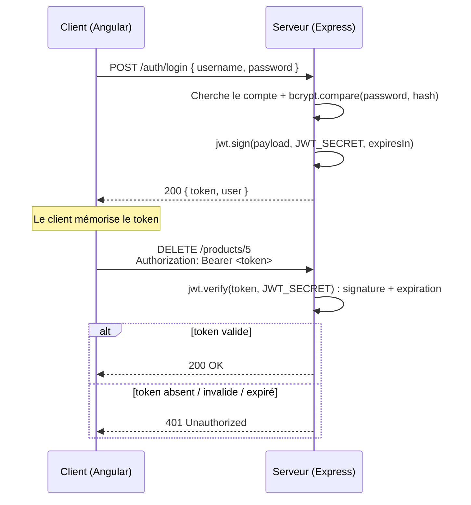

# Tutoriel — Ajouter l'authentification JWT au backend `Express-API-REST`

Ce tutoriel explique **pas à pas** comment l'authentification par **token JWT** a été ajoutée à ce backend. Il suppose que vous connaissez déjà le projet de départ (Express 5 + TypeScript, routeur `/products`) mais que vous n'avez **jamais** mis en place d'authentification par token.

À la fin, vous saurez refaire l'ensemble **seul**, en partant du dépôt tel qu'il était avant les modifications.

> Les comptes utilisateurs sont stockés **en mémoire** (un tableau), comme les produits. Ils sont **perdus à chaque redémarrage**. C'est parfait pour apprendre ; en production, on utiliserait une vraie base de données.

La partie Angular (login, intercepteur, guard) est expliquée dans `public/docs/13_Authentification_JWT.md` du projet front.

---

## Sommaire

1. [Comprendre l'authentification par token](#1-comprendre-lauthentification-par-token)
2. [Ce qui est protégé, et pourquoi](#2-ce-qui-est-protégé-et-pourquoi)
3. [Étape 1 — Installer les dépendances](#3-étape-1--installer-les-dépendances)
4. [Étape 2 — Configurer les variables d'environnement](#4-étape-2--configurer-les-variables-denvironnement)
5. [Étape 3 — Les types (`data/user.ts`)](#5-étape-3--les-types-datauserts)
6. [Étape 4 — Le stockage des comptes (`data/userList.ts`)](#6-étape-4--le-stockage-des-comptes-datauserlistts)
7. [Étape 5 — Le service (`services/authService.ts`)](#7-étape-5--le-service-servicesauthservicets)
8. [Étape 6 — Le middleware (`middleware/authenticateJWT.ts`)](#8-étape-6--le-middleware-middlewareauthenticatejwtts)
9. [Étape 7 — Les routes `/auth` (`routes/authRouter.ts`)](#9-étape-7--les-routes-auth-routesauthrouterts)
10. [Étape 8 — Brancher le tout](#10-étape-8--brancher-le-tout)
11. [Tester](#11-tester)
12. [Erreurs fréquentes](#12-erreurs-fréquentes)
13. [Pour aller plus loin](#13-pour-aller-plus-loin)
14. [Récapitulatif sécurité](#14-récapitulatif-sécurité)

---

## 1. Comprendre l'authentification par token

### Le problème

HTTP est **sans mémoire** : chaque requête est indépendante. Si Alice s'est identifiée il y a 2 secondes, le serveur ne s'en souvient pas à la requête suivante. Il faut donc que **chaque requête prouve** l'identité de l'appelant.

### La solution : le JWT

Un **JWT** (JSON Web Token) est un « badge » que le serveur remet au client après une connexion réussie. Le client le **présente à chaque requête**. Le badge est une chaîne de 3 parties séparées par des points :

```
eyJhbGciOiJIUzI1NiJ9 . eyJzdWIiOiIxIiwidXNlcm5hbWUiOiJhZG1pbiJ9 . biyJxxqRGqcPI-AkDBIFCW
      header                        payload                           signature
```

| Partie | Contenu | Exemple décodé |
|---|---|---|
| **header** | l'algorithme de signature | `{ "alg": "HS256", "typ": "JWT" }` |
| **payload** | les données (« claims ») | `{ "sub": "1", "username": "admin", "role": "admin", "iat": 1791815830, "exp": 1791819430 }` |
| **signature** | empreinte calculée avec la **clé secrète** du serveur | (illisible) |

Dans le payload : `sub` = identifiant de l'utilisateur, `iat` = date d'émission, `exp` = date d'expiration (en secondes depuis 1970).

### Deux idées essentielles à retenir

1. **Un JWT est signé, pas chiffré.** N'importe qui peut lire le payload (c'est juste du Base64). En revanche, personne ne peut le **modifier** sans casser la signature. Conséquence : **ne jamais mettre de secret** (mot de passe…) dans un token.
2. **Le serveur ne stocke pas les tokens.** Pour savoir si un token est authentique, il recalcule la signature avec sa clé secrète et la compare. C'est l'authentification **stateless** (sans état). Si la clé secrète fuit, n'importe qui peut fabriquer de faux tokens : elle doit rester **secrète**.

### Le déroulé complet



### Authentification vs autorisation

- **Authentification** : « *qui es-tu ?* » → le login + le token. C'est ce que fait ce tutoriel.
- **Autorisation** : « *as-tu le droit de faire ça ?* » → par exemple, réservé aux admins. Voir [§13](#13-pour-aller-plus-loin).

### Pourquoi hacher les mots de passe (bcrypt) ?

On ne stocke **jamais** un mot de passe en clair : si la base fuit, tous les comptes sont compromis. On stocke un **hash** : une empreinte à sens unique. `bcrypt` ajoute un « sel » aléatoire (deux utilisateurs ayant le même mot de passe auront des hashs différents) et est volontairement **lent** (ralentit les attaques par force brute).

On ne « déchiffre » jamais un hash : pour vérifier un mot de passe, `bcrypt.compare` re-hache la saisie et compare les résultats.

---

## 2. Ce qui est protégé, et pourquoi

| Route | Accès |
|---|---|
| `POST /auth/register`, `POST /auth/login` | public (il faut pouvoir se connecter !) |
| `GET /auth/me` | **token requis** |
| `GET /products/...` (lecture) | public |
| `POST /products`, `PUT /products/:id`, `DELETE /products/:id`, `DELETE /products/name/:name` | **token requis** |

On protège les routes qui **modifient** des données. La lecture reste publique pour ne pas casser les pages Angular qui ne demandent pas de connexion. Pour tout protéger (même la lecture), voir [§13.1](#131-protéger-toutes-les-routes-dun-routeur).

> **Rappel important** : la vraie sécurité est **toujours côté serveur**. Un *guard* Angular ne fait que masquer une page ; n'importe qui peut appeler l'API directement (curl, Postman…). C'est le middleware décrit plus bas qui protège réellement les données.

---

## 3. Étape 1 — Installer les dépendances

Depuis le dossier `backEnd/Express-API-REST` :

```powershell
npm install jsonwebtoken bcryptjs
npm install -D @types/jsonwebtoken
```

- **jsonwebtoken** : `jwt.sign()` crée un token, `jwt.verify()` le vérifie.
- **bcryptjs** : hachage des mots de passe, 100 % JavaScript (pas de compilation native, plus simple sous Windows que `bcrypt`). Cette version embarque ses propres types TypeScript : pas de `@types/bcryptjs`.

---

## 4. Étape 2 — Configurer les variables d'environnement

On ne met **jamais** une clé secrète dans le code (elle finirait dans git). On la lit dans une variable d'environnement, définie dans un fichier `.env` **non versionné** (il est déjà dans `.gitignore`).

1. Le fichier `.env.example` (versionné) sert de **modèle** :

   ```env
   PORT=3000
   JWT_SECRET=remplacez-moi-par-une-longue-valeur-aleatoire
   JWT_EXPIRES_IN=1h
   ```

2. Chaque développeur le copie vers `.env` et met **sa** valeur :

   ```powershell
   Copy-Item .env.example .env
   # Générer une vraie clé aléatoire :
   node -e "console.log(require('crypto').randomBytes(48).toString('hex'))"
   ```

   Collez le résultat comme valeur de `JWT_SECRET` dans `.env`.

| Variable | Rôle |
|---|---|
| `JWT_SECRET` | clé qui **signe** les tokens. Longue, aléatoire, secrète. |
| `JWT_EXPIRES_IN` | durée de vie d'un token (`15m`, `1h`, `7d`…). Plus c'est court, moins un token volé est dangereux. |

**Qui lit le fichier `.env` ?** Le script `dev` utilise déjà `dotenv-cli` (`dotenv -- tsc-watch ...`). Nous avons fait pareil pour `start` dans `package.json` :

```json
"start": "tsc && dotenv -- node dist/index.js"
```

Sans cela, `npm start` ne chargerait pas `.env` et le serveur refuserait de démarrer (voir étape 5).

---

## 5. Étape 3 — Les types (`data/user.ts`)

```ts
export type Role = "user" | "admin";

export interface IUser {
  id: string;
  username: string;
  passwordHash: string;   // jamais le mot de passe en clair
  role: Role;
}

export type PublicUser = Omit<IUser, "passwordHash">;

export interface JwtPayload {
  sub: string;
  username: string;
  role: Role;
}
```

Trois types, trois usages :

- `IUser` : le compte **stocké** (avec le hash).
- `PublicUser` : ce qu'on **renvoie** au client. `Omit<IUser, "passwordHash">` = « `IUser` sans le hash ». Ainsi on ne risque pas de fuiter le hash par mégarde.
- `JwtPayload` : ce qu'on met **dans** le token.

---

## 6. Étape 4 — Le stockage des comptes (`data/userList.ts`)

Même principe que `ProductList` : une classe avec un tableau privé et une instance unique exportée (`userListManager`).

```ts
export class UserList {
  private users: IUser[] = [];
  private nextId = 1;

  findByUsername(username: string) { ... }
  findById(id: string) { ... }
  add(username: string, passwordHash: string, role: Role): IUser { ... }
}

export const userListManager = new UserList();
```

Cette classe **ne connaît ni bcrypt ni JWT** : elle ne fait que stocker. Si vous passez plus tard à une vraie base de données, c'est **uniquement ce fichier** qui changera.

---

## 7. Étape 5 — Le service (`services/authService.ts`)

C'est le cœur de la logique : mots de passe + tokens.

### a) La clé secrète : on refuse de démarrer sans elle

```ts
const JWT_SECRET = process.env.JWT_SECRET;
if (!JWT_SECRET) {
  throw new Error("JWT_SECRET manquant : copiez .env.example vers .env et renseignez-le.");
}
```

Une valeur de secours « en dur » dans le code (`|| "secret"`) serait dangereuse : on risquerait de l'oublier en production, et tout le monde la connaîtrait (elle est dans git). Mieux vaut **planter au démarrage**.

### b) Inscription : hacher le mot de passe

```ts
const passwordHash = await bcrypt.hash(password, SALT_ROUNDS);
return toPublicUser(userListManager.add(username, passwordHash, "user"));
```

- `SALT_ROUNDS = 10` : le « coût » du hachage (10 est une valeur courante).
- Le rôle est **toujours `"user"`**, jamais lu dans la requête : sinon n'importe qui pourrait s'inscrire avec `"role": "admin"` (élévation de privilèges).

### c) Connexion : vérifier puis signer

```ts
const user = userListManager.findByUsername(username);
if (!user || !(await bcrypt.compare(password, user.passwordHash))) {
  return null;
}

const payload: JwtPayload = { sub: user.id, username: user.username, role: user.role };
const token = jwt.sign(payload, JWT_SECRET, { expiresIn: JWT_EXPIRES_IN });
```

Remarquez que « utilisateur inconnu » et « mauvais mot de passe » renvoient le **même** résultat (`null`) : on ne doit pas indiquer à un attaquant quels noms d'utilisateur existent.

### d) Vérification d'un token

```ts
jwt.verify(token, JWT_SECRET, { algorithms: ["HS256"] })
```

`verify` contrôle **la signature ET la date d'expiration** et lève une erreur si l'une est invalide. L'option `algorithms` impose l'algorithme attendu (bonne pratique : on ne laisse pas le token « choisir » comment il doit être vérifié).

### e) Compte de démonstration

En bas du fichier, un compte `admin` / `admin123` est créé au démarrage pour tester immédiatement. **À supprimer en production.**

---

## 8. Étape 6 — Le middleware (`middleware/authenticateJWT.ts`)

Un **middleware** Express est une fonction `(req, res, next)` exécutée **avant** le handler de la route. Il peut :

- laisser passer en appelant `next()` ;
- ou bloquer en répondant lui-même (ici `401`).

```ts
export function authenticateJWT<P>(req: Request<P>, res: Response, next: NextFunction) {
  const authHeader = req.headers.authorization;

  if (!authHeader || !authHeader.startsWith("Bearer ")) {
    return res.status(401).json({ message: "Token manquant ..." });
  }

  const token = authHeader.substring("Bearer ".length).trim();

  try {
    req.user = authService.verifyToken(token);
    next();
  } catch (error) {
    const message = error instanceof jwt.TokenExpiredError ? "Token expiré" : "Token invalide";
    res.status(401).json({ message });
  }
}
```

Déroulé :

1. Lire l'en-tête `Authorization`. Convention : `Authorization: Bearer <token>` (« Bearer » = « porteur »).
2. Extraire le token.
3. Le vérifier. S'il est bon, on range son contenu dans **`req.user`**, puis `next()` : le handler suivant peut savoir **qui** appelle.
4. Sinon → **`401 Unauthorized`**.

### Deux points TypeScript à connaître

**1. Ajouter `user` au type `Request`.** Express ne connaît pas `req.user`. On « augmente » son type :

```ts
declare global {
  namespace Express {
    interface Request {
      user?: JwtPayload;
    }
  }
}
```

**2. Le paramètre générique `<P>`.** Sans lui, une fois le middleware placé devant un handler, TypeScript n'arrive plus à déduire que `req.params.id` est une `string` : il devient `string | string[]` et la compilation échoue sur les appels comme `productListManager.deleteProduct(productId)`. Le `<P>` laisse TypeScript déduire le type des paramètres depuis la route. Si vous écrivez un middleware sans et que vous obtenez l'erreur `Argument of type 'string | string[]' is not assignable...`, c'est la cause.

---

## 9. Étape 7 — Les routes `/auth` (`routes/authRouter.ts`)

| Route | Rôle | Middleware |
|---|---|---|
| `POST /auth/register` | créer un compte | aucun (public) |
| `POST /auth/login` | renvoie `{ token, user }` | aucun (public) |
| `GET /auth/me` | profil de l'utilisateur du token | `authenticateJWT` |

Points d'attention :

- **Valider `req.body`** : un client peut envoyer n'importe quoi. On vérifie `typeof ... === "string"` et des longueurs minimales avant d'utiliser les valeurs.
- **Codes HTTP** : `201` (créé), `400` (données invalides), `401` (non authentifié), `409` (conflit : nom déjà pris).
- **Message de login générique** : « Identifiants invalides », qu'il s'agisse du nom ou du mot de passe.
- **Handlers `async`** : Express 5 transmet automatiquement à l'`errorHandler` les erreurs levées dans un handler `async`, pas besoin de `try/catch`.
- **Dans `/me`**, le middleware est placé **entre** le chemin et le handler : sans token valide, on n'atteint jamais le handler.

```ts
authRouter.get("/me", authenticateJWT, (req, res) => {
  const user = authService.getUserById(req.user!.sub);
  ...
});
```

---

## 10. Étape 8 — Brancher le tout

### a) Monter le routeur `/auth` dans `server.ts`

```ts
import { authRouter } from "./routes/authRouter";
...
app.use("/auth", authRouter);
app.use("/products", productsRouter);
```

### b) Protéger les routes d'écriture dans `productsRouter.ts`

On insère `authenticateJWT` **entre le chemin et le handler** :

```ts
import { authenticateJWT } from "../middleware/authenticateJWT";

productsRouter.post("/", authenticateJWT, (req, res) => { ... });
productsRouter.put("/:id", authenticateJWT, (req, res) => { ... });
productsRouter.delete("/name/:name", authenticateJWT, (req, res) => { ... });
productsRouter.delete("/:id", authenticateJWT, (req, res) => { ... });
```

Les routes `GET` restent inchangées.

### c) CORS

Le front (`http://localhost:4200`) et l'API (`http://localhost:3000`) sont sur des origines différentes. Le `cors()` déjà présent dans `server.ts` autorise l'en-tête `Authorization` : rien à changer. (Sans CORS, le navigateur bloquerait les appels.)

---

## 11. Tester

### Avec le fichier `api-test.http` (extension *REST Client* de VS Code)

Le fichier contient maintenant une section **AUTHENTIFICATION JWT** : exécutez d'abord la requête `login`, puis les suivantes réutilisent automatiquement le token (`{{token}}`).

### Avec PowerShell

```powershell
# 1) Démarrer le serveur
npm run dev

# 2) Sans token : 401
Invoke-RestMethod -Method Delete http://localhost:3000/products/5

# 3) Connexion
$r = Invoke-RestMethod -Method Post http://localhost:3000/auth/login `
  -ContentType 'application/json' -Body '{"username":"admin","password":"admin123"}'
$r.token

# 4) Avec token : 200
Invoke-RestMethod -Method Delete http://localhost:3000/products/5 `
  -Headers @{ Authorization = "Bearer $($r.token)" }
```

### Résultats attendus

| Requête | Code |
|---|---|
| `GET /products` sans token | `200` |
| `POST /products` sans token | `401` « Token manquant » |
| `POST /auth/login` mauvais mot de passe | `401` « Identifiants invalides » |
| `POST /auth/login` correct | `200` + `token` |
| `GET /auth/me` avec le token | `200` |
| `GET /auth/me` avec `Bearer abc.def.ghi` | `401` « Token invalide » |
| `POST /auth/register` avec un nom déjà pris | `409` |

### Inspecter un token

Collez un token sur [jwt.io](https://jwt.io) : vous verrez le payload en clair. Cela illustre le point du §1 : **signé mais pas chiffré**. (Ne collez jamais un token de production sur un site tiers.)

### Tester l'expiration

Dans `.env`, mettez `JWT_EXPIRES_IN=10s`, redémarrez, connectez-vous, attendez 10 secondes, rappelez `/auth/me` → `401` « Token expiré ».

---

## 12. Erreurs fréquentes

| Symptôme | Cause probable |
|---|---|
| `Error: JWT_SECRET manquant` au démarrage | `.env` absent ou `JWT_SECRET` vide. Copiez `.env.example` vers `.env`. |
| `401 Token invalide` alors que le token vient d'être reçu | le serveur a été redémarré avec un **autre** `JWT_SECRET` ; ou le token contient des guillemets/retours à la ligne ; ou le préfixe `Bearer ` (avec l'espace) est oublié. |
| `401 Token manquant` depuis Angular | l'intercepteur n'est pas enregistré, ou l'URL de la requête n'est pas celle de l'API. |
| Erreur de compilation `string \| string[]` sur `req.params` | le middleware n'est pas générique (`<P>`), voir §8. |
| Erreur CORS dans la console du navigateur | `app.use(cors())` doit être placé **avant** les routes. |
| Les comptes créés disparaissent | normal : stockage en mémoire, perdu au redémarrage. |

---

## 13. Pour aller plus loin

### 13.1. Protéger toutes les routes d'un routeur

Au lieu de répéter le middleware sur chaque route, on peut le placer **en haut du routeur** : il s'applique à toutes les routes déclarées après.

```ts
productsRouter.use(authenticateJWT);
productsRouter.get("/", ...);   // désormais protégée aussi
```

### 13.2. Restreindre à un rôle (autorisation)

Le rôle est déjà dans le token. On peut écrire un second middleware, à placer **après** `authenticateJWT` :

```ts
export function requireRole(...roles: Role[]) {
  return (req: Request, res: Response, next: NextFunction) => {
    if (!req.user || !roles.includes(req.user.role)) {
      return res.status(403).json({ message: "Accès refusé : rôle insuffisant" });
    }
    next();
  };
}

// Suppression réservée aux admins :
productsRouter.delete("/:id", authenticateJWT, requireRole("admin"), handler);
```

`401` = « je ne sais pas qui tu es » ; `403` = « je sais qui tu es, mais tu n'as pas le droit ».

### 13.3. Limites de ce montage

- **Pas de révocation** : un token reste valide jusqu'à son expiration, même après déconnexion côté client. D'où l'intérêt d'une durée courte.
- **Refresh token** : pour des sessions longues sans reconnexion, on utilise un second token longue durée qui sert à obtenir de nouveaux tokens courts.
- **Anti force brute** : limiter le nombre de tentatives sur `/auth/login` (ex. paquet `express-rate-limit`).
- **HTTPS obligatoire** en production : sans HTTPS, le token circule en clair.
- **Vraie base de données** pour les comptes.

---

## 14. Récapitulatif sécurité

- Mots de passe **hachés** avec bcrypt, jamais stockés ni renvoyés en clair.
- `JWT_SECRET` long, aléatoire, dans `.env` (non versionné), serveur qui refuse de démarrer sans lui.
- Tokens avec **expiration** (`JWT_EXPIRES_IN`).
- Algorithme de vérification **imposé** (`HS256`).
- Rôle **jamais** accepté depuis le client à l'inscription.
- Message de login **générique**.
- Entrées **validées** à la frontière de l'application (`req.body`).
- Protection appliquée **côté serveur** : le front n'est qu'une commodité d'affichage.

### Fichiers concernés

| Fichier | Action |
|---|---|
| `package.json` | + `jsonwebtoken`, `bcryptjs` ; script `start` avec `dotenv` |
| `.env.example` | **nouveau** (modèle) ; `.env` local non versionné |
| `src/data/user.ts` | **nouveau** : types |
| `src/data/userList.ts` | **nouveau** : stockage en mémoire |
| `src/services/authService.ts` | **nouveau** : bcrypt + JWT |
| `src/middleware/authenticateJWT.ts` | **nouveau** : gardien |
| `src/routes/authRouter.ts` | **nouveau** : `/auth/*` |
| `src/server.ts` | monte `/auth` |
| `src/routes/productsRouter.ts` | protège POST / PUT / DELETE |
| `api-test.http`, `DOC.md` | requêtes et documentation mises à jour |
